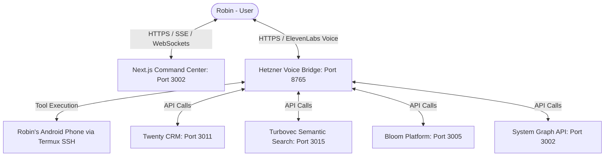

# Project Handover: Thrivbe Voice Agent & Command Center Triage Suite

This document serves as the comprehensive handover summary for the **Thrivbe Voice Agent (Rachel)** and the **Triage Suite** integrated within the **Command Center**. It outlines the system architecture, file structures, API endpoints, current state, and execution instructions.

---

## 1. System Architecture

The project spans two primary codebases communicating over a secure Tailscale network:

1. **Thrivbe Command Center (Next.js App)**
   - **Directory:** `/Users/robinsverd/Thrivbe-AI/projects/command-center`
   - **Port:** `3002` (local)
   - **Database:** Local SQLite database storing synchronized inbox items, actions, tasks, and sync logs.
   - **Role:** Main operator dashboard. Features the **Triage Suite** (Inbox, Approvals, Activity) and hosts the frontend interface for the Voice Agent.

2. **Voice Agent (FastAPI Backend / "Voice Bridge")**
   - **Directory:** `/Users/robinsverd/Thrivbe-AI/lab/voice-agent`
   - **Host:** Hetzner Cloud Server (`thrivbe-1`)
   - **Tailscale Address:** `https://hetzner.tail9908c7.ts.net:8765`
   - **Role:** Speech recognition, LLM routing, and tool-calling execution framework. Translates spoken/typed requests into system actions.



---

## 2. Completed Implementations & Refinements

### A. Triage Suite (Command Center Dashboard)
- **Inbox Page (`src/app/inbox/page.tsx`):**
  - Displays real-time unified inbox entries (Email, LinkedIn, Notion Tasks, Beeper) populated in SQLite.
  - Controls to archive, convert to task, auto-draft replies, or delegate task descriptions to Rachel.
- **Approvals Deck (`src/app/approvals/page.tsx`):**
  - Lists pending actions requiring explicit user review before execution.
  - Integrates `PayloadPreview.tsx` to format and render complex parameters (JSON configurations, code diffs, text messages).
  - Resolving an approval with `"approve"` immediately executes the queued action via the backend `ActionBus.executeQueued` engine.
- **Activity Log (`src/app/activity/page.tsx`):**
  - Features a vertical audit timeline with actor-category filter pills (**All**, **Sync**, **Task**, **Agent Ops**).
- **Dual Workspaces Overview Widget (`src/components/WorkspacesOverview.tsx`):**
  - Placed directly on the Overview landing page below the weekly widgets.
  - **Bloom Platform Card:** Fetches live active projects, pending tasks, and OKR progress meters directly from the local Bloom database.
  - **Thrivbe Notion Card:** Displays your active Notion projects and pending tasks filtered specifically to the `"thrivbe"` workspace.

### B. Dynamic Voice Agent Interface (WPA)
- **Hybrid Input Bar (`src/components/VoiceBriefController.tsx`):**
  - Removed static titles; replaced them with a responsive text input field next to the microphone icon.
  - Tapping the mic initiates voice recognition; typing a message and clicking **Send** routes queries via a text-only pipeline.
  - Placeholder text reflects active status (*"Listening..."*, *"Rachel is thinking..."*, *"Rachel is speaking..."*).
  - An animated wave icon bounces inside the text bar when audio is playing back.
- **No Layout Jumping:** Repositioned the scroll mechanics from window-level `scrollIntoView()` to target container `.scrollTop` offsets to keep your browser screen perfectly still during updates.
- **Enlarged Log Terminal:** Expanded log logs box height from `h-44` to `h-72` to allow comfortable auditing of tool outputs.

### C. Advanced FastAPI Backend Features (`server.py`)
- **Upgraded Whisper Model:** Upgraded default speech recognition from `"tiny"` to **`"small"`** (244M parameters) to drastically improve transcription accuracy for specific names (e.g. Henrik, Bloom, Twenty).
- **Dynamic Model Sizing:** Reads from the `WHISPER_MODEL_SIZE` env variable, allowing you to switch to `"base"` or `"medium"` without editing code.
- **Spoken Summary Splitting (`===`):**
  - The voice agent is instructed to format responses with a `===` divider.
  - Rachel only speaks the brief conversational summary before the divider aloud.
  - The full, long list of data after the divider is outputted directly to the web logs, keeping voice interactions brief and readable.
- **Robust Termux Warnings Parsing:** Parses and swallows Termux Google Play API helper deprecation warning strings without crashing JSON converters.

### D. Multi-System Tool Suite
The voice agent is now equipped with the following native capabilities:
1. **Twenty CRM Querying (`twenty_search_contacts`):** Search contacts inside your local Twenty CRM instance on port `3011`.
2. **Turbovec Semantic Search (`semsearch_query`):** Searches LinkedIn network nodes or Notion YouTube/Niche databases on port `3015`.
3. **Android Telephony & Device Control (robin-t via SSH):**
   - `android_list_contacts`: Fetches contact names and phone numbers.
   - `android_make_call`: Dials phone numbers.
   - `android_set_clipboard`: Sets phone clipboard strings.
   - `android_get_notifications`: Pulls and summarizes active notifications.
4. **Bloom Platform (`bloom_create_task`, `bloom_list_projects`, etc.):** Creates tasks and lists workspaces.
5. **Dynamic Self-Learning (`teach_agent_tool`):** Writes, compiles, and registers python scripts to dynamically load new voice agent capabilities.

---

## 3. Operational Guide

### Service Controls (Command Center & Bloom)
Run these commands locally on your Mac:
```bash
# Check running status of Command Center and dependent daemons
./boot-command-center.sh --status

# Stop all Command Center services
./boot-command-center.sh --stop

# Restart Command Center and Odysseus
./boot-command-center.sh

# Start local Bloom platform dev server
cd "projects/Asana Clone Project"
npm run dev
```

### Voice Backend Controls (Hetzner Cloud)
Log onto the Hetzner server (`ssh hetzner`) to manage the FastAPI service:
```bash
# Restart Voice Bridge
systemctl restart voice-bridge

# Stop Voice Bridge
systemctl stop voice-bridge

# Monitor live log outputs
journalctl -u voice-bridge -f -n 50
```

---

## 4. Key Configuration Files
- **Command Center Env:** `/Users/robinsverd/Thrivbe-AI/projects/command-center/.env`
- **Voice Bridge Env (Hetzner):** `/opt/voice-bridge/.env` (contains ElevenLabs, Twenty CRM, and Bloom base configurations).
- **FastAPI Code:** [server.py](file:///Users/robinsverd/Thrivbe-AI/lab/voice-agent/server.py) (Main backend endpoint logic).
- **Dashboard Component:** [VoiceBriefController.tsx](file:///Users/robinsverd/Thrivbe-AI/projects/command-center/src/components/VoiceBriefController.tsx) (Frontend component handling SSE streams and hybrid inputs).
