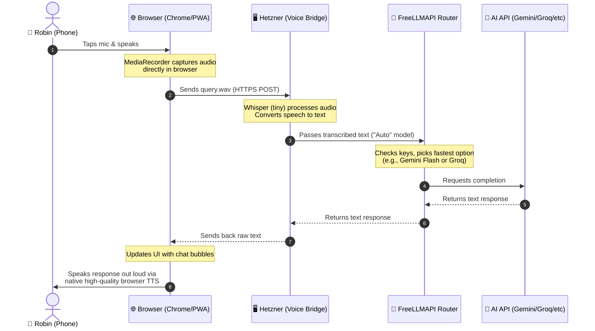

# Thrivbe Voice Agent (Lab Project)

An autonomous, voice-controlled agentic interface that runs over Tailscale HTTPS. It connects Robin's Android device directly to his Hetzner server infrastructure, allowing voice-based command execution, phone control, server monitoring, and recursive self-learning capabilities.

## Architecture Diagram



---

## Features

### 1. 🎙️ Browser-Native PWA Client
- **Hold-to-Talk (Push-to-Talk):** Unified pointer and touch events allow the user to hold the mic button down to record and release to send.
- **Speech Interruption:** Tapping the mic button at any point during AI voice output instantly stops the audio playback via `window.speechSynthesis`.
- **Developer Console Reflecting:** A fullscreen monospaced console log streams live events from the server (speech transcription, tool calls, execution statuses, and replies) directly to the phone screen.
- **Standalone Mode:** Fully configured Web App Manifest allows Chrome to install it as a fullscreen app, completely hiding the browser search bar and URL panel.

### 2. 🧠 Stateful Session Memory
- Keeps a rolling memory history of up to 12 messages (6 full conversation turns) on the client side.
- Sends the JSON-stringified dialogue history automatically with every voice request, allowing the AI to retain full context even across backend server updates.

### 3. ⚙️ Agentic Tool Execution
- **`get_phone_status`:** Runs over SSH via Tailscale to query `termux-battery-status` on the phone, returning battery level, charging state, and CPU/battery temperature.
- **`vibrate_phone`:** Bypasses SSH limitations (caused by Android's signature verification) by triggering native haptic vibration (`navigator.vibrate`) directly inside Chrome on the client side.
- **`send_sms`:** Securely connects over SSH to target `termux-sms-send` on the phone, sending background text messages automatically.
- **`run_server_command`:** Executes local shell commands on the Hetzner host (with safety blocklists to prevent destructive commands).
- **`bloom_*` integration:** Connects over Tailscale to the Bloom local API running on Robin's MacBook (`100.96.126.87:3005`). Exposes:
  - `bloom_list_projects`: Lists all visible projects in the workspace.
  - `bloom_list_tasks`: Retrieves tasks, filterable by project, status, or search query.
  - `bloom_create_task`: Installs new tasks directly into target project boards.
  - `bloom_update_task`: Modifies task status (todo, in_progress, done) or titles.
  - `bloom_comment_task`: Appends conversational updates or agent logs to specific task timelines.
- **`graph_*` integration:** Connects over Tailscale to the Command Center system map (graph) API on Robin's MacBook (`100.96.126.87:3002`). Exposes:
  - `graph_search`: Searches the system map graph for files, concepts, or wiki pages, returning snippets.
  - `graph_get_node`: Inspects a specific node's description and neighborhood connections.
  - `graph_get_document`: Reads full text contents of catalog markdown/wiki documents.
  - `graph_register_node`: Registers or links new external components, tools, or agents directly into the system graph.

### 4. 🧠 Dynamic Self-Learning Loop
- Equipped with **`teach_agent_tool`** which allows the AI to improve its own capabilities recursively.
- If asked to perform a task it does not know how to do (e.g. check on a Docker container, fetch weather, check disk usage), the AI writes a Python function.
- It executes `teach_agent_tool` which compiles and registers the function into `dynamic_registry.json`.
- The backend server triggers a graceful 2-second background restart. On startup, it dynamically executes all registered functions, adding them as fully operational tools into the AI's available functions list.

---

## Directory Structure

```
voice-agent/
├── index.html                 # PWA Frontend UI (Developer Console)
├── manifest.json              # Web App Manifest for Fullscreen Installation
├── sw.js                      # Service Worker for PWA Caching Requirements
├── server.py                  # FastAPI Backend & Event Streaming Server
├── voice-bridge.service       # Systemd service configuration for Hetzner
├── dynamic_registry.json      # Dynamic registry for self-taught Python tools
└── certs/                     # Tailscale HTTPS SSL certificates (Let's Encrypt)
    ├── cert.crt
    └── cert.key
```

---

## Deployment & Management on Hetzner

### 1. Paths
- Backend location: `/opt/voice-bridge/`
- Python virtual environment: `/opt/voice-bridge/bin/python3`
- Logs location: systemd journal

### 2. Systemd Commands
```bash
# Check status of the Voice Bridge service
systemctl status voice-bridge

# Restart the service manually
systemctl restart voice-bridge

# View live unbuffered logs
journalctl -u voice-bridge -f
```

---

## Secure Tailscale SSL Setup
The server is accessible on:
`https://hetzner.tail9908c7.ts.net:8765`

Certificates are generated on the server using Tailscale's native Let's Encrypt integration:
```bash
tailscale cert --cert-file cert.crt --key-file cert.key hetzner.tail9908c7.ts.net
```
This guarantees fully trusted, local HTTPS encryption without public exposure.
