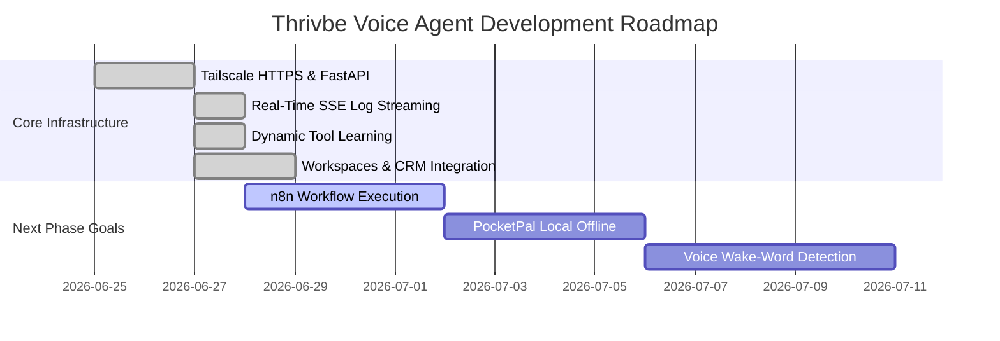

# Project Roadmap: Thrivbe Voice Agent

This document tracks everything we did to build the Voice Agent, key milestones completed, and future developmental targets.

---

## 1. Completed Milestones

### Phase 1: Device Connectivity & Termux Environment Setup
- **SSH Debugging:** Re-established secure SSH connectivity to Robin's Android phone (`robin-t`) on port `8022` using key authentication over Tailscale.
- **Wake Lock Configuration:** Identified and configured Termux's background processing wake locks (`termux-wake-lock`) to stop Android's battery manager from killing long-running tasks.
- **Dependency Cleanups:** Installed required libraries (`python`, `sox`, `espeak`, `build-essential`, `rust`) and purged unnecessary build cache files to free up 273MB of phone storage.

### Phase 2: Core Server & HTTPS PWA Architecture
- **Tailscale HTTPS Certs:** Generated real, trusted Let's Encrypt SSL certificates for the local domain (`hetzner.tail9908c7.ts.net`) using `tailscale cert`.
- **FastAPI Backend:** Built `server.py` on Hetzner containing the FastAPI application, integrating:
  - **Whisper STT:** Native local audio transcription using the `tiny` model.
  - **FreeLLMAPI Router:** Smart routing of completions through Robin's local LLM pool (Groq, Cerebras, Gemini, Nvidia) to avoid direct API rate limits.
- **Web App Manifest & Service Worker:** Integrated a clean manifest configuration and registered a service worker (`sw.js`) to allow a standalone, fullscreen browser installation in Chrome with no URL bar.

### Phase 3: Premium UI & Real-Time Event Streaming
- **Developer Console UI:** Shifted the focus of the app to a fullscreen, scrolling green-on-black monospace console reflecting logs directly from the server.
- **Hold-to-Talk & Interrupts:** Added unified touch/pointer event handlers for push-to-talk. Wired instant speech cancellation (`window.speechSynthesis.cancel()`) on key actions to allow Robin to interrupt the AI immediately.
- **Real-Time Log Streaming:** Converted the `/ask` endpoint to a Server-Sent Events (SSE) stream, delivering live logs (Whisper status, tool calls, tool results) to the console window as they occur.

### Phase 4: State Memory, Self-Learning, & Core Integrations
- **Rolling Chat Memory:** Built client-side history tracking (limit of 12 messages) that automatically appends to the request payload to allow context retention across server reloads.
- **Self-Taught Tools:** Created `teach_agent_tool`. The agent can write python functions on the fly, compile them, register them to `dynamic_registry.json`, and trigger a systemd graceful restart of the service to dynamically append new capabilities into its global namespace.
- **Bloom Integration:** Exposed native tools to query Robin's agent-native Asana Clone (Bloom) running locally on his MacBook (`100.96.126.87:3005`) over Tailscale, allowing list projects, list/create/update tasks, and post comments directly from the voice agent.
- **System Graph Integration:** Fixed Command Center dev server bind configurations to allow Tailscale requests, and exposed native graph tools (`graph_search`, `graph_get_node`, `graph_get_document`, `graph_register_node`) to search/inspect/navigate your local knowledge base.

### Phase 5: Voice Bridge Upgrades & Layout Refinements
- **Twenty CRM Tool Suite:** Integrated query and contact search capabilities inside the local Twenty CRM container on port `3011`.
- **Turbovec Semantic Search:** Added search tools for LinkedIn connections and Notion AAA databases on port `3015`.
- **Deep Android Control:** Enabled hands-free phone calls, notifications list audit, clipboard syncing, and contacts filtering.
- **Dynamic Speech/Text Splitting (`===`):** Programmed Rachel to output brief summaries for ElevenLabs playback before a `===` divider, while streaming full lists/details straight to the screen.
- **Upgraded Whisper Model:** Swapped out the inaccurate `"tiny"` transcription model for the much higher fidelity **`"small"`** model, cached directly on the server CPU.
- **Hybrid Input Console:** Added a full-width chat input field inside the PWA client card, enabling keyboard queries alongside standard hold-to-talk mic options.
- **Jumping Resolution:** Replaced auto-scroll hooks to target local container offsets, eliminating browser jumping.

---

## 2. Future Development Roadmap

### Phase 6: n8n Workflow Triggers
- **Trigger Tools:** Create a generic `trigger_n8n_workflow` tool that calls the local n8n instance to kick off automated workflows using voice commands.
- **Hetzner Status Dashboard:** Provide tools to view and control other Docker containers (Hermes, Trading System) directly from the voice console.

### Phase 7: Offline Fallback & Local Models
- **PocketPal API Bridge:** Connect the offline fallback to PocketPal's local API server running on the phone. If Tailscale/Internet goes offline, route audio transcription and LLM calls to the local Qwen 2.5 3B model in PocketPal.

### Phase 8: Hands-Free Haptics & Wake Word
- **Voice Activation:** Build a lightweight wake-word listener (like "Hey Thrivbe") that automatically triggers the microphone recorder, allowing hands-free agent interactions.
